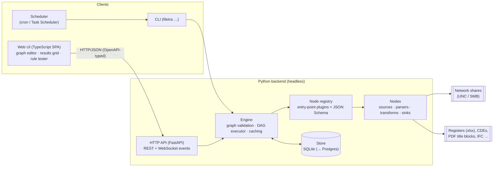

# filetra: architecture proposal

Status: **proposal / for review**. No code yet. This document proposes a skeleton, languages and
architecture for filetra, a general-purpose metadata ETL pipeline for AEC project documents. It
also reviews each choice critically.

---

## 1. Problem restated

- **Volume:** project shares hold anywhere from 10⁵ to 10⁷ files. They are deep, messy, and
  often reached over SMB/VPN.
- **Implicit metadata:** the meaning sits in *paths and filenames*. Examples:
  `\\fs01\Projects\P1234 Riverside\05 Shared\Architecture\P1234-ARP-ZZ-01-DR-A-1001_C02.pdf`
  carries the project, the CDE state, the discipline, ISO 19650 fields and a revision.
- **Logical vs physical:** one *document* (`P1234-ARP-ZZ-01-DR-A-1001`) has many *revisions*
  (P01…P05, C01, C02). Each revision has many *renditions* (pdf, dwg, rvt export), and those
  sit in several *locations* (WIP, Shared, Published, Superseded).
- **Enrichment:** tags, mapping to code lists and registers, aggregation (latest revision per
  document, counts per discipline/status, register vs disk reconciliation).
- **Extensibility:** many specialised functions (extractors, parsers, mappers) need a common
  typed contract, so they can be composed. In the end they are composed visually.
- **Constraints:** Python is preferred. A GUI is the end goal, ideally node-based visual
  programming. The GUI and processing must stay separate. The backend must read file systems, so a
  pure-browser app is not an option.

---

## 2. Recommended architecture (summary)



The principles below drive everything else:

1. **The engine is a headless Python library.** The CLI and the HTTP API are thin shells over it.
   The GUI is one client among several. Every engine feature can be used and tested without a
   GUI.
2. **The pipeline graph is a document (JSON), and that document is the contract.** The GUI edits
   the graph document and the engine executes it. Neither side needs the other's code. Graphs can
   be versioned in git, diffed and run headless on a schedule.
3. **Nodes describe themselves.** Each node type publishes its ports, its port types and a
   JSON Schema for its configuration. The GUI builds its palette and config forms from that
   description, the same way ComfyUI does. Adding a node therefore never needs a GUI change.
4. **Data moves as tables, not as messages.** Nodes exchange columnar tables (Polars/Arrow) with
   declared schemas, not per-row messages. That choice is what makes 10⁶+ rows practical and lets
   the GUI preview the output of any node.
5. **Every value records where it came from.** Each derived attribute records which node, rule
   and source produced it, plus a confidence. Conflicts between sources (filename vs register vs
   title block) are resolved explicitly, never silently.

---

## 3. Language choices, critically reviewed

### 3.1 Backend / engine: **Python 3.12+** (recommended)

| For | Against | Mitigation |
|---|---|---|
| Fast iteration and refactoring, which suits domain rules that change weekly | Weak static guarantees | `pyright --strict` / `mypy --strict` in CI; pydantic for runtime validation at boundaries |
| Data ecosystem: Polars, DuckDB, openpyxl, PyMuPDF/pdfplumber (title blocks), ifcopenshell (IFC), ezdxf (DXF) | CPU-bound per-row Python is slow | Columnar Polars expressions for heavy work; a scan is I/O-bound anyway (SMB latency dominates) |
| `os.scandir` is efficient. On Windows, `DirEntry.stat()` is answered from the directory listing without an extra system call | GIL | Directory walking is I/O-bound, so a thread pool works fine; free-threaded 3.13+ is a later bonus |
| Large pool of people who can write plugins (engineers who script) | Packaging into a desktop app is awkward | See §6. Keep packaging out of the core design entirely |

**Alternatives rejected:**

- **Rust or Go for the core.** Both give single binaries and raw speed, but they would slow down
  the part that changes most: domain rules. The scan is bound by network latency, not CPU, so the
  speed gain is small. *Kept in reserve:* if profiling ever shows a hot path (such as hashing or
  scanning), write a PyO3 extension for just that path.
- **TypeScript/Node end-to-end** (which would pair naturally with Total.js or Node-RED). One
  language would be attractive, but Node's ecosystem for AEC formats and tabular data is much
  weaker, and it goes against the stated Python preference.
- **C#/.NET.** This is the native language of the Revit, Navisworks and Tekla APIs, and it has
  strong desktop UI. It isn't worth it for the core, but a future **Revit adapter** should be a
  separate .NET process that talks to the engine through the same node/API contract.

### 3.2 Frontend: **TypeScript + React + React Flow (xyflow)** (recommended)

| For | Against |
|---|---|
| React Flow is *only a canvas library* (MIT). We own the graph model, so it maps 1:1 to the graph JSON | We have to build the node palette, inspector and run controls ourselves, though these are generated from the registry |
| Very large ecosystem: data grids (AG Grid Community / TanStack Table / Glide), JSON Schema forms (RJSF / JSON Forms) | A second language and toolchain (npm) in the repo |
| TypeScript types are generated from the backend OpenAPI (`openapi-typescript`), so the cross-language contract is type-checked | Front-end skills are needed on the team |

### 3.3 Visual programming library: critical comparison

| Option | Verdict | Reasoning |
|---|---|---|
| **Total.js Flow** | ✗ Not recommended | Flow is a complete *Node.js application with its own runtime*: components run inside Flow. Using it with a Python engine means **two execution engines**, with Python calls from each component over HTTP or a subprocess. You would fight its model instead of using it. The community is smaller and the English docs are thin. |
| **Node-RED** | ✗ | Same problem: message-per-event execution in Node.js. It fits IoT, not batch tabular ETL. |
| **React Flow (xyflow)** | ✓ **Recommended** | A pure UI canvas with no execution model to fight. It is mature and widely used. |
| **Rete.js v2** | ~ Viable alternative | Also framework-agnostic and TypeScript. Its optional JS dataflow engine isn't needed. The community is smaller than React Flow's. |
| **LiteGraph.js (ComfyUI lineage)** | ~ Viable | ComfyUI proves the exact pattern (Python node classes → `/object_info` → generated browser UI). Canvas rendering performs well, but the code base is older and less idiomatic to extend. |
| **Qt desktop (PySide6 + NodeGraphQt / Ryven)** | ✗ for now | Everything stays in Python, but the GUI becomes tied to the engine process. Qt node editors and data grids take a lot of work to make good, and remote/server use isn't possible. |

**Critical caveat on visual programming itself.** Node graphs are good for *coarse topology*:
"scan → parse naming → map codes → group revisions → export". They are poor for *fine logic*
such as regexes, code-list mappings and precedence rules. Keep nodes **coarse-grained** and
configure the logic inside each node with purpose-built editors: a naming-convention builder
with live test strings, mapping tables and rule lists. Also expect that many users never touch
the graph and only pick a **preset pipeline** and adjust the naming convention. For that
reason the **results grid and rule tester should ship before the graph editor** (see roadmap).

---

## 4. Engine skeleton

### 4.1 Repository layout

```
filetra/
├─ pyproject.toml              # uv-managed; hatchling build; entry points for plugins
├─ src/filetra/
│  ├─ core/
│  │  ├─ model.py              # domain entities (Location, FileObject, Document, Revision, …)
│  │  ├─ tables.py             # named table schemas used as port types
│  │  ├─ protocols.py          # Source / Transform / Sink protocols, NodeContext
│  │  ├─ registry.py           # @node decorator, entry-point discovery, catalog export
│  │  ├─ graph.py              # graph document model (pydantic) + validation
│  │  ├─ executor.py           # topological run, per-node caching, cancellation, events
│  │  └─ provenance.py         # Assertion model, precedence/reconciliation
│  ├─ store/
│  │  ├─ base.py               # repository interface
│  │  ├─ sqlite.py             # default store (WAL mode)
│  │  └─ migrations/
│  ├─ nodes/                   # built-in nodes, registered exactly like third-party ones
│  │  ├─ sources/fs_scan.py
│  │  ├─ sources/listing_file.py   # import a saved listing (dir /s, CSV) for offline work
│  │  ├─ parse/path_segments.py
│  │  ├─ parse/naming_convention.py
│  │  ├─ parse/revision.py
│  │  ├─ transform/codelist_map.py
│  │  ├─ transform/tag_rules.py
│  │  ├─ transform/group_documents.py
│  │  ├─ transform/reconcile.py
│  │  ├─ aggregate/summary.py
│  │  └─ sinks/{csv,excel,store}.py
│  ├─ conventions/             # presets as data: iso19650.yaml, revision schemes, code lists
│  ├─ api/                     # FastAPI app: catalog, graphs, runs, results, events
│  └─ cli.py                   # Typer: scan, run, nodes, serve, validate
├─ web/                        # TypeScript SPA (separate package.json, built to static files)
├─ tests/
│  ├─ fixtures/trees/          # synthetic directory trees as text files
│  └─ …
└─ docs/
```

### 4.2 Typing / protocol system

There are two layers. Each covers a gap in the other.

1. **Static:** `typing.Protocol` defines the shape of each node kind, so plugin authors get
   editor and type-checker support without inheriting from a base class.
2. **Runtime:** a `@node` decorator registers *metadata* that protocols cannot carry: id, version,
   category, typed ports, the config model and the UI hints. `runtime_checkable` only checks method
   names, so the registry must hold the real contract in any case.

```python
# core/protocols.py (sketch)
class NodeContext(Protocol):
    run_id: str
    log: Logger
    def progress(self, done: int, total: int | None = None, msg: str = "") -> None: ...
    def cancelled(self) -> bool: ...
    def state(self) -> StateStore: ...          # per-node persisted state (e.g. last scan)

class Source(Protocol):
    def read(self, ctx: NodeContext) -> Iterator[pl.DataFrame]: ...   # chunked output

class Transform(Protocol):
    def run(self, ctx: NodeContext, **inputs: pl.DataFrame) -> Mapping[str, pl.DataFrame]: ...

class Sink(Protocol):
    def write(self, ctx: NodeContext, **inputs: pl.DataFrame) -> SinkResult: ...
```

```python
# nodes/parse/naming_convention.py (sketch)
class FieldSpec(BaseModel):
    name: str                              # "originator"
    pattern: str | None = None             # regex for the token
    code_list: str | None = None           # validate against a named code list
    optional: bool = False

class NamingConventionConfig(BaseModel):
    preset: Literal["iso19650", "custom"] = "iso19650"
    delimiter: str = "-"
    fields: list[FieldSpec] = []
    revision_suffix: str | None = r"[_ ](?P<revision>[PCA]\d{2})$"

@node(
    id="filetra.parse.naming_convention", version=1, category="parse",
    inputs={"files": tables.FileObjects},
    outputs={"parsed": tables.ParsedFields, "rejects": tables.ParseRejects},
    config=NamingConventionConfig,
)
class NamingConventionParser:
    def __init__(self, config: NamingConventionConfig) -> None: ...
    def run(self, ctx, files): ...           # → {"parsed": ..., "rejects": ...}
```

**Port types** are *named table schemas* (`FileObjects`, `ParsedFields`, `Documents`,
`Revisions`, `Assertions`, …). Each one is a set of column names, dtypes and required flags. An
edge is valid when the output schema satisfies the input schema (structural, so extra columns are
allowed). Both the GUI (while drawing an edge) and the engine (`filetra validate graph.json`)
check this.

**Simple functions:** a `@transform` shorthand wraps a plain function
`def f(df: pl.DataFrame, cfg: Cfg) -> pl.DataFrame`, so most plugins stay a few lines long.

**Plugin discovery:** via `importlib.metadata` entry points (`[project.entry-points."filetra.nodes"]`).
A firm-specific package (`filetra-acme`) adds nodes and conventions without forking.

**Critique:**
- *Polars as the "type" of data in transit couples every plugin to Polars.* This is acceptable:
  Polars converts to and from Arrow, pandas and dicts cheaply. Expose helpers for plugin authors
  who prefer `list[dict]`.
- *Schema checking at edges can be overly strict or loose.* Start structural and minimal (required
  columns plus dtypes). Don't adopt a heavyweight schema library (pandera) until it's needed.
- *Versioning:* every node type carries `version`. Each config model includes a migration hook,
  so saved graphs keep loading after nodes evolve. This is cheap now and costly to retrofit.

### 4.3 Graph document (the GUI ↔ engine contract)

```json
{
  "format": "filetra.graph/1",
  "name": "Riverside – disk register",
  "nodes": [
    {"id": "scan",  "type": "filetra.source.fs_scan@1",
     "config": {"roots": ["\\\\fs01\\Projects\\P1234"], "exclude": ["**/~$*", "**/Thumbs.db"]}},
    {"id": "name",  "type": "filetra.parse.naming_convention@1", "config": {"preset": "iso19650"}},
    {"id": "group", "type": "filetra.transform.group_documents@1", "config": {"revision_scheme": "iso19650"}},
    {"id": "xlsx",  "type": "filetra.sink.excel@1", "config": {"path": "out/register.xlsx"}}
  ],
  "edges": [
    {"from": "scan.files",   "to": "name.files"},
    {"from": "name.parsed",  "to": "group.parsed"},
    {"from": "group.latest", "to": "xlsx.rows"}
  ],
  "ui": {"positions": {"scan": [0, 0], "name": [240, 0]}}
}
```

`ui` is opaque to the engine. Keeping layout separate from semantics keeps diffs clean.

### 4.4 Executor

- Topological execution of a DAG, with cycle detection during validation.
- **Per-node caching:** the cache key is a hash of the node type and version, its config, and the
  cache keys of its inputs. Re-running after a regex change only recomputes downstream nodes, which
  makes a live "preview this node" in the GUI practical.
- Cancellation, progress events (published to the API → WebSocket) and structured run logs.
- **Build vs adopt:** Dagster, Prefect and Airflow are server-heavy and designed for engineers
  writing Python DAGs, not for user-edited graphs. Hamilton is close in spirit, but it builds graphs
  from function signatures, not from a document. A purpose-built executor is about 300 lines. The
  risk is slowly re-implementing an orchestrator, so keep scheduling outside (cron or Task
  Scheduler calling the CLI) and refuse scope creep.

### 4.5 Domain model

| Entity | Identity | Notes |
|---|---|---|
| **Location** | root id + UNC root | Paths are stored as *(root_id, relative_path)*, so a remapped drive or share move is a single update. Mapped drive letters are normalised to UNC. |
| **Snapshot** | scan run id | Each scan is a snapshot. Diffs between snapshots give added, removed, modified and moved files. |
| **FileObject** | (root, rel_path) per snapshot | size, mtime, ctime, is_dir, extension, optional hash (lazy) |
| **Document** | normalised document number | the logical item. Its identity is *never* the path. |
| **Revision** | (document, revision code) | ordered by a pluggable **revision scheme** |
| **Rendition** | (revision, format) | the same revision as pdf, dwg, … |
| **Assertion** | (entity, attribute, value, source, rule, confidence, run) | the provenance backbone (below) |
| **CodeList / Mapping** | name + version | loaded from xlsx/csv. Used for validation and mapping. |
| **Tag** | entity + tag + source | manual or rule-derived |

**Assertions (provenance) model.** Every node that derives metadata emits *assertions* instead of
overwriting columns. Example: `doc P1234-…-1001 / title = "GA Plan Level 01"` from
*register.xlsx*, confidence 1.0, and `… / title = "GA PLAN L01"` from *pdf-titleblock*,
confidence 0.7. A **reconcile** node applies precedence rules and materialises a "current
view" wide table.

*Critique:* this is essentially EAV, which is flexible but slow and awkward to query directly.
Mitigation: assertions are the *audit store*, and query-facing tables are materialised
projections, rebuilt incrementally. Without provenance, users can't trust or debug the results,
and in this domain trust is what decides adoption.

### 4.6 Storage

| Option | Use |
|---|---|
| **SQLite (WAL)** ✓ default | Zero administration, a single file per workspace, enough for 10⁷ rows. **Never place it on a network share** (SMB locking is unreliable), only on local disk or the server. |
| **DuckDB** | Excellent for analytical queries and exports. Polars can query it directly. Writes come from a single process. Use it as an *analytical sidecar* or export format, not as the system of record. |
| **PostgreSQL** | Server or multi-user mode later. Hide it behind the `store` interface (SQLAlchemy Core keeps the SQL portable). |

---

## 5. First source: file-system scan (specifics)

The hard parts here are operational, not algorithmic:

- **Scale and latency:** walk directories in parallel with a thread pool (`os.scandir`), producing
  chunks of about 50k rows, so memory stays flat and progress can be streamed.
- **Incremental scanning:** NTFS directory mtimes change only when *direct children* are added,
  removed or renamed, not for nested changes or content edits. The USN journal isn't available
  over SMB. So the baseline is a **full rescan diffed against the previous snapshot**. A
  directory-mtime fast path is an *optional heuristic*, and the user is told when it's in use.
- **Move/rename detection:** match removed and added files by (size, mtime, name similarity).
  Content hashing over SMB is expensive, so it's opt-in and only used to confirm.
- **Windows hazards:** paths over 260 characters (common in AEC folder hierarchies) need the `\\?\`
  prefix or LongPathsEnabled. Other hazards: `PermissionError` on ACL-restricted folders (record
  and continue, never abort), case-insensitive collisions, invalid or odd Unicode, offline files
  and DFS links, `~$` lock files, `Thumbs.db` and `.DS_Store`.
- **Offline development:** a `listing_file` source that imports a saved listing (CSV or
  `dir /s /b` output) lets parsers be built and tested without access to a share. It's also a
  good way to onboard a project from a client-supplied listing.

### 5.1 Path and filename semantics

The meaning comes from three places, and each one gets a dedicated node:

1. **Path segments** (`path_segments`): positional or pattern rules relative to a root. Examples:
   "segment 1 = `P\d{4} name` → project", "a segment matching `(WIP|Shared|Published|Archive)` →
   CDE state", "`Superseded` anywhere → superseded=true".
2. **Naming convention** (`naming_convention`): ISO 19650 / BS 1192 field parsing with code-list
   validation. It emits **partial results, a confidence and reasons**, and *never drops rows*.
   Non-conforming names go to a `rejects` output, and reviewing that output is a core user
   workflow, not an edge case.
3. **Revision** (`revision`): extracts the revision and status from a suffix, brackets or a
   register. **Revision schemes are pluggable comparators**: ISO 19650 (P01 < P02 < C01), alpha
   (A < B … Z < AA), numeric and firm-specific. Sequence order and status semantics (preliminary
   vs contractual) belong to the scheme.

Conventions ship as **data** (`conventions/*.yaml`), not code. A firm can then encode its own
standard without writing Python, and the GUI can edit them.

*Critique:* naming conventions are applied inconsistently in practice. Regex-per-field is
brittle, so add a fallback tokeniser (split on `-`, `_` and spaces, then fuzzy-match tokens to code
lists) that produces lower-confidence assertions. Don't attempt ML or LLM classification until the
deterministic pipeline and the reject-review workflow exist. When it comes, it is just another
node that emits low-confidence assertions.

---

## 6. GUI ↔ backend separation and packaging

The separation itself is simple: **HTTP + JSON with an OpenAPI contract, plus a WebSocket for run
events.** The SPA builds to static files, and the backend can serve them. This one decision keeps
every deployment option below open, with **no code changes** between them.

| Mode | How | For | Against |
|---|---|---|---|
| **A. Server / service** ✓ *first* | The backend runs as a Windows service or container *near the file server*; users open a browser | No desktop packaging. Scans run next to the data (fast). One install. Shared results. | Needs auth. **The service account can see every file, so results could expose folders a user can't open.** Map users to permissions or limit roots per user. Linux containers must mount SMB (credentials, Kerberos). |
| **B. Desktop via pywebview** ✓ *second* | One Python process runs FastAPI on `127.0.0.1:<random>` with a per-launch token, inside a native webview (WebView2 on Windows); frozen with PyInstaller | Single toolchain (Python only at runtime), small, and the user's own share permissions apply | Fewer shell features (auto-update, tray). **PyInstaller binaries are often flagged by corporate antivirus**, so budget for code signing. |
| **C. Desktop via Tauri + Python sidecar** | A Rust shell bundles the SPA and launches the frozen backend as a sidecar | Polished installer, auto-update, small footprint | Three toolchains (Rust, Node, Python) plus sidecar lifecycle management. Worth it only once B hits its limits. |
| **D. Electron + sidecar** | As C, with Chromium bundled | Most mature | Large (150 MB+) and still needs the Python sidecar. No advantage over C here. |

**Recommendation:** design for A and B from the start, because they are the same artifact. Treat
C as an upgrade path. Whichever mode is used, the local API must bind to loopback only and require
a token, because otherwise any web page could call a localhost file-system API.

---

## 7. API surface (initial)

```
GET  /api/catalog                 node types, ports, config JSON Schemas, UI hints
GET  /api/conventions             naming conventions, revision schemes, code lists
POST /api/conventions/test        {convention, samples[]} → parsed fields + reasons (live tester)
CRUD /api/graphs                  graph documents
POST /api/graphs/{id}/validate    type and schema checks → errors per node and edge
POST /api/runs                    {graph, target_node?} → run id   (target_node = preview)
GET  /api/runs/{id}               status, per-node stats
WS   /api/runs/{id}/events        progress, logs, node completion
GET  /api/results/{table}         paginated, filterable, sortable rows (grid)
GET  /api/entities/{id}/provenance  assertions behind each value
```

---

## 8. Roadmap (phased so that each phase is useful on its own)

| Phase | Deliverable | Why this order |
|---|---|---|
| **0. Core + CLI** | model, protocols, registry, graph and executor, SQLite store; nodes `fs_scan`, `listing_file`, `path_segments`, `naming_convention` (ISO 19650 preset), `revision`, `group_documents`, CSV/Excel sinks; `filetra run graph.json` | Tests the hardest assumption, *can we infer reliable metadata from real paths?*, with real data before any GUI investment |
| **1. API** | FastAPI over the engine: catalog, runs, results, convention tester, events | Makes the contract concrete. OpenAPI then generates the TS types. |
| **2. Web UI: results first** | results grid with filters, a provenance drawer, a rejects review, a naming-convention builder and tester | Highest user value, and needs no graph editor |
| **3. Web UI: graph editor** | React Flow canvas driven by `/catalog`, schema-generated config forms, per-node preview | Built once nodes and contracts have stabilised |
| **4. More sources and enrichment** | Excel drawing registers, PDF title-block extraction, CDE APIs (ACC/BIM 360, Aconex, Viewpoint, SharePoint), IFC/DWG properties, tag rules, reconciliation, dashboards | Each is just a new node |
| **5. Deployment and multi-user** | service mode with auth, Postgres, pywebview desktop build, scheduling and change notifications | Packaging comes last, when there is something worth packaging |

---

## 9. Key risks and open questions

| Risk | Mitigation |
|---|---|
| Building a visual programming environment absorbs the project | Results-first UI, coarse nodes and preset pipelines. The graph editor is phase 3. |
| Real-world filenames are messier than any convention | Partial parsing, confidence scores, a rejects workflow and a fuzzy fallback. Measure the parse rate on real shares in phase 0. |
| Network scan performance and permissions | Run near the data (server mode), parallel walk, chunked snapshots, resilient error handling. |
| Data exposure through a privileged service account | Per-user root scoping or permission mapping before multi-user rollout. |
| Saved graphs break as nodes evolve | Node versioning and config migrations from day one. |
| Packaging friction in corporate IT (AV, signing, admin rights) | Server mode first. Sign desktop builds. Install per user with no admin rights. |

**Questions for you:**
1. Single user on a workstation, or a shared server per office/firm? This decides whether phase 5
   starts with A or B.
2. Which naming standards are in scope beyond ISO 19650 (firm-specific, client-specific,
   legacy BS 1192, US NCS)?
3. Rough scale: the number of files per project share and the number of shares?
4. Is write-back in scope (renaming or moving files, stamping metadata), or is the tool strictly
   read-only? I recommend **read-only** for safety until the inference is trusted.
5. Must outputs go to existing systems (CDE, ERP, Power BI), which affects which sinks get
   priority?
