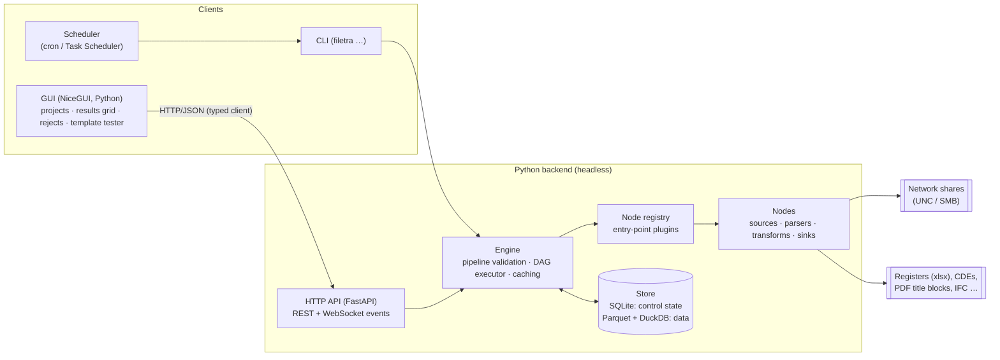

# filetra: architecture proposal

Status: **proposal / for review**. No code yet. This document proposes a skeleton, languages and
architecture for filetra, a general-purpose metadata ETL pipeline for AEC project documents. It
also reviews each choice critically.

---

## 0. Decisions so far

| # | Question | Decision | Consequences in this document |
|---|---|---|---|
| D1 | Users | **Single user for now.** Multi-user may come later. | The first deployment is a **local desktop app** (§6, mode B). It runs with the user's own share permissions, so there is no auth or data-exposure problem yet. Keep the `store` interface so Postgres/server mode remains possible. |
| D2 | Naming conventions | **Fixed naming modules first.** Configurable company/project/client conventions come later. | Naming parsers sit behind a `NamingConvention` protocol (§5.1). Phase 0 ships hand-written modules (ISO 19650 and others). A data-driven, GUI-editable convention is added later as just another implementation of the same protocol. |
| D3 | Scale | **Thousands of projects × about 1,000 files ≈ 10⁶ files at the start**, possibly 10⁸–10⁹ later. They sit on **only one or two shares**, so a project is a folder (or folders) on a share, not a share. | Storage moves to **partitioned Parquet with DuckDB/Polars** for the data and SQLite for control state (§4.6). Execution is **partitioned per project** (§4.4). **Project discovery** is a first-class part of the design (§5.2). Because everything is on one or two file servers, how hard the scanner hits each server matters more than the total parallelism. Excel can't be a primary output because of its 1,048,576-row limit. |
| D4 | Write-back | **Read-only.** | This is enforced by design. Sources only get a read-only file-system interface, and nothing in the engine opens files on a share for writing (§5). |
| D5 | Outputs | **Easy human/machine-readable formats** (CSV, JSON). | The primary sinks are **CSV, JSON Lines and JSON**. Parquet is the internal format and an optional export. Excel is a convenience sink for small filtered views only (§4.7). |
| D6 | Hashing | **No content hashing for now.** Only the metadata that is cheap to collect. | The scan collects only what a directory listing and stat give: name, path, is_dir, size, mtime, ctime, extension and Windows attributes. No file content is read, so the scan never touches access times. Move detection uses size, mtime and name only (§5). Hashing stays a possible later add-on node. |
| D7 | Project folder names | **A customisable template system: regex with named groups, stored as YAML (D8).** | A small, reusable **pattern-template engine** (§5.3) extracts key data such as the project number, name and client from project folder names. Templates are data, not code, and carry their own test examples. The same engine is designed for reuse later by `path_segments` and by data-driven naming conventions (D2). |
| D8 | Configuration format | **All configuration files are YAML.** | Pipelines (§4.3), pattern templates (§5.3), overrides and app settings are all `.yaml`. Loading is strict so that YAML's implicit typing can't corrupt values (§4.8). JSON stays only where it isn't configuration: HTTP API payloads, `json`/`jsonl` exports and the export `manifest.json`. JSON *Schema* is still generated from the pydantic models and validates the YAML files. |
| D9 | Visual programming | **Dropped.** There is no node-based visual editor. | Pipelines are YAML files, written by hand or shipped as presets (§4.3). The GUI covers only operating the tool and reviewing results: projects and scan status, the results grid, the rejects review and template testing (§3.2). Without a graph canvas there's no reason to build a TypeScript front end, so the GUI moves to **Python (NiceGUI)** behind the same HTTP API. The Total.js, React Flow and similar comparisons are removed. |

---

## 1. Problem restated

- **Volume:** thousands of projects of about 1,000 files each to start (10⁶ files), on one or two
  network shares. The design must also handle 10⁸–10⁹ files (D3). The folder trees are deep, messy,
  and often reached over SMB/VPN.
- **Implicit metadata:** the meaning sits in *paths and filenames*. Examples:
  `\\fs01\Projects\P1234 Riverside\05 Shared\Architecture\P1234-ARP-ZZ-01-DR-A-1001_C02.pdf`
  carries the project, the CDE state, the discipline, ISO 19650 fields and a revision.
- **Logical vs physical:** one *document* (`P1234-ARP-ZZ-01-DR-A-1001`) has many *revisions*
  (P01…P05, C01, C02). Each revision has many *renditions* (pdf, dwg, rvt export), and those
  sit in several *locations* (WIP, Shared, Published, Superseded).
- **Enrichment:** tags, mapping to code lists and registers, aggregation (latest revision per
  document, counts per discipline/status, register vs disk reconciliation).
- **Extensibility:** many specialised functions (extractors, parsers, mappers) need a common
  typed contract, so they can be composed into pipelines.
- **Constraints:** Python is preferred. A GUI is the end goal (without visual programming, D9).
  The GUI and processing must stay separate. The backend must read file systems, so a
  pure-browser app is not an option.

---

## 2. Recommended architecture (summary)



The principles below drive everything else:

1. **The engine is a headless Python library.** The CLI and the HTTP API are thin shells over it.
   The GUI is one client among several. Every engine feature can be used and tested without a
   GUI.
2. **A pipeline is a YAML document.** It lists the nodes and how their inputs and outputs connect,
   and the engine executes it. Pipelines are written by hand or copied from shipped presets, and
   can be versioned in git, diffed and run headless on a schedule. There is no visual editor (D9).
3. **Nodes describe themselves.** Each node type publishes its inputs, outputs, their table types
   and a schema for its configuration. That description drives pipeline validation, `filetra nodes`
   (a CLI listing of every node and its settings), generated reference docs, and editor
   autocomplete for pipeline YAML.
4. **Data moves as tables, not as messages.** Nodes exchange columnar tables (Polars/Arrow) with
   declared schemas, not per-row messages. That choice is what makes 10⁶+ rows practical and lets
   you preview the output of any node (`filetra run pipeline.yaml --until <node> --head 100`).
5. **Every value records where it came from.** Each derived attribute records which node, rule
   and source produced it, plus a confidence. Conflicts between sources (filename vs register vs
   title block) are resolved explicitly, never silently.

---

## 3. Language choices, critically reviewed

### 3.1 Backend / engine: **Python 3.12+** (recommended)

| For | Against | Mitigation |
|---|---|---|
| Fast iteration and refactoring, which suits domain rules that change weekly | Weak static guarantees | `pyright --strict` / `mypy --strict` in CI; pydantic for runtime validation at boundaries |
| Data ecosystem: Polars, DuckDB, openpyxl, PyMuPDF/pdfplumber (title blocks), ifcopenshell (IFC), ezdxf (DXF) | CPU-bound per-row Python is slow | Columnar Polars expressions for heavy work; a scan is I/O-bound anyway (SMB latency dominates) |
| `os.scandir` is efficient. On Windows, `DirEntry.stat()` is answered from the directory listing without an extra system call | GIL | Directory walking is I/O-bound, so a thread pool works fine; free-threaded 3.13+ is a later bonus |
| Large pool of people who can write plugins (engineers who script) | Packaging into a desktop app is awkward | See §6. Keep packaging out of the core design entirely |

**Alternatives rejected:**

- **Rust or Go for the core.** Both give single binaries and raw speed, but they would slow down
  the part that changes most: domain rules. The scan is bound by network latency, not CPU, so the
  speed gain is small. *Kept in reserve:* if profiling ever shows a hot path (such as hashing or
  scanning), write a PyO3 extension for just that path.
- **TypeScript/Node end-to-end.** Node's ecosystem for AEC formats and tabular data is much
  weaker than Python's, and it goes against the stated Python preference.
- **C#/.NET.** This is the native language of the Revit, Navisworks and Tekla APIs, and it has
  strong desktop UI. It isn't worth it for the core, but a future **Revit adapter** should be a
  separate .NET process that talks to the engine through the same node/API contract.

### 3.2 GUI: **NiceGUI (Python)** behind the HTTP API (recommended)

Without visual programming (D9), the GUI is a fairly conventional operations-and-review app:
- **Projects:** the discovered list, with scan status per project and actions to start a scan.
- **Runs:** start a pipeline, follow its progress, read its logs.
- **Results grid:** filter, sort and page through 10⁶+ rows. Paging happens on the server
  (DuckDB), never in the browser.
- **Provenance:** a drawer showing where each value came from.
- **Rejects review:** the files whose names didn't parse.
- **Template tester:** type a folder name and see which template matched and what it extracted,
  then edit and save the template YAML.

None of that needs a custom canvas, which was the main reason for a TypeScript front end.

| Option | Verdict | Reasoning |
|---|---|---|
| **NiceGUI** | ✓ **Recommended, with the state mitigations below** | *Python only*, so there's one language and one toolchain. It is built on FastAPI with Vue/Quasar components. It includes AG Grid, server-paged tables, forms, a code editor and live-updating elements. `native=True` runs it in a pywebview window, which gives the desktop app (§6, mode B) almost for free, and the same app also runs in a browser. |
| TypeScript + React SPA | ~ Upgrade path | It offers the most control and the largest ecosystem, but adds a second language, npm and front-end skills. Only worth it if NiceGUI's limits are hit. Because the GUI talks only to the HTTP API, it can be swapped later without touching the engine. |
| Qt (PySide6) | ~ **Python-only fallback** | A real desktop app, so window state is never lost and nothing reconnects, and its model/view tables handle millions of rows very well. On the other hand, development is slower, it can't be used from a browser, PyInstaller bundles are large, and it is harder to restyle. |
| Streamlit | ✗ | Its "re-run the whole script on every interaction" model fights a stateful app with long-running scans and server-side paging. |
| Dash | ~ Python alternative | The front end is a client-side React app and callbacks are plain HTTP requests. A backgrounded tab keeps its DOM, scroll and state (`persistence=True`), and `dash-ag-grid` supports server-side row models. On the other hand, larger apps tangle into callback chains, and live progress needs polling. |
| Panel | ✗ | Server-side state over a WebSocket, so it has the same reconnect problem as NiceGUI without its advantages. |

#### NiceGUI state retention (known weakness, mitigated)

**The problem.** NiceGUI keeps the UI tree and its state *on the server*, tied to a WebSocket. When
a window is put aside, browsers throttle background tabs and the socket drops. If it doesn't
reconnect within `reconnect_timeout` (**default 3 s**), the server deletes that client. On
reconnect the page is then rebuilt from scratch: in-memory state is gone, everything redraws, and
there's a visible delay.

**Tested** (NiceGUI 4.0, Chromium, 12 s simulated disconnect, a page with a server-side counter
and a JS marker):

| Setting | After reconnect |
|---|---|
| default `reconnect_timeout=3` | **page reloaded**: JS marker gone, server state reset (`count 2` → `count 0`) |
| `reconnect_timeout=3600` | **no reload**: marker, server state (`count 2`) and scroll position all intact |

**Mitigations, in order of effect:**
1. **Set a long `reconnect_timeout`** (hours) in `ui.run(...)`. The server keeps the client
   alive, and the browser reattaches silently with no redraw, keeping its scroll position. For a
   single-user app the memory cost of keeping a client alive is negligible. This removes the
   common case entirely.
2. **Persist view state explicitly for the cases (1) can't cover.** Those are a browser
   discarding a background tab (Chrome Memory Saver), the app restarting, or the user pressing F5.
   - Keep the selected project, filters, sort, page and grid column state in `app.storage.tab`
     (per tab) or `app.storage.user` (persisted across restarts).
   - Record the grid position with AG Grid's state API and a debounced scroll handler, and
     restore it on build with `initialState` and `ensureIndexVisible`.
   - This restores *where you were*, but a redraw and a short delay remain in these cases.
3. **Make rebuilds cheap.** Pages build their skeleton immediately and fetch data asynchronously.
   The results grid uses server-side paging, so a rebuild fetches about 100 rows, not 10⁶. Page
   rebuild never re-queries or re-runs anything expensive.
4. **Desktop mode (§6 B):** the pywebview window isn't subject to Chrome's tab discarding. With
   (1) in place, minimising the window and coming back is seamless. Server restarts are covered
   by (2).

**When to abandon NiceGUI instead:** if, after (1)–(3), the remaining reloads are still
unacceptable, the root cause is architectural (view state lives on the server), and it can only be
removed by a GUI whose view state lives *in the client*:
- **Qt (PySide6):** stays Python-only and suits desktop-first single-user use (D1).
- **A TypeScript SPA:** the most robust option, and it also works in a browser, but adds a second
  language.

Either one replaces only `filetra.gui`. The engine, API and client are unaffected.

**Keeping GUI and engine separate in an all-Python stack.** Using one language makes it tempting
for the GUI to import the engine directly. Prevent that:
- The GUI lives in `filetra.gui` and may import only **`filetra.client`**, a typed API client, plus
  the shared pydantic schemas. An **import-linter** contract in CI enforces this.
- `filetra.client` uses `httpx`. In the desktop app it runs **in-process** (`httpx.ASGITransport`
  pointed at the engine's FastAPI app), so no socket is needed. Against a remote engine (§6 mode A)
  it uses normal HTTP. The GUI code is the same in both cases.

**Critique:**
- *NiceGUI is a smaller project than React.* The UI is server-driven (see state retention above): each interaction is a
  WebSocket round-trip to Python. That's ideal for a local single-user app and fine on a LAN, but
  highly custom widgets are harder to build. The API boundary is the hedge, because the GUI can be
  replaced without touching the engine.
- *The GUI process does real work* (rendering and paging state), so long-running engine work must
  never run on its event loop. Runs go to the engine's executor, and the GUI only subscribes to
  progress events.

---

## 4. Engine skeleton

### 4.1 Repository layout

```
filetra/
├─ pyproject.toml              # uv-managed; hatchling build; entry points for plugins
├─ src/filetra/
│  ├─ core/
│  │  ├─ model.py              # domain entities (Location, FileObject, Document, Revision, …)
│  │  ├─ tables.py             # named table schemas used as port types
│  │  ├─ protocols.py          # Source / Transform / Sink protocols, NodeContext
│  │  ├─ registry.py           # @node decorator, entry-point discovery, node reference export
│  │  ├─ pipeline.py           # pipeline document model (pydantic) + validation
│  │  ├─ executor.py           # topological run, per-node caching, cancellation, events
│  │  ├─ provenance.py         # Assertion model, precedence/reconciliation
│  │  └─ templates.py          # pattern-template engine: regex compile, match, format (§5.3)
│  ├─ config.py               # strict YAML loading → pydantic models, schema export (§4.8)
│  ├─ store/
│  │  ├─ base.py               # repository interfaces (control store, dataset store)
│  │  ├─ control_sqlite.py     # roots, projects, runs, cache index, scan checkpoints
│  │  ├─ datasets.py           # partitioned Parquet datasets (per project), DuckDB views
│  │  └─ migrations/
│  ├─ nodes/                   # built-in nodes, registered exactly like third-party ones
│  │  ├─ sources/project_discovery.py # roots + rules (+ optional CSV) → Projects
│  │  ├─ sources/fs_scan.py
│  │  ├─ sources/listing_file.py   # import a saved listing (dir /s, CSV) for offline work
│  │  ├─ parse/path_segments.py
│  │  ├─ parse/naming_convention.py # dispatches to a NamingConvention module
│  │  ├─ parse/revision.py
│  │  ├─ transform/codelist_map.py
│  │  ├─ transform/tag_rules.py
│  │  ├─ transform/group_documents.py
│  │  ├─ transform/reconcile.py
│  │  ├─ aggregate/summary.py
│  │  └─ sinks/{csv,jsonl,json,parquet,excel}.py
│  ├─ conventions/             # NamingConvention modules (iso19650.py, …), revision schemes, code lists
│  │                           #   later: data-driven conventions (YAML templates) as another implementation
│  ├─ templates/               # example config: projects.example.yaml, pipeline.example.yaml
│  ├─ api/                     # FastAPI app: projects, pipelines, runs, results, templates, events
│  ├─ client.py                # typed httpx client (HTTP or in-process ASGI transport)
│  ├─ gui/                     # NiceGUI app; may import only filetra.client + schemas (import-linter)
│  ├─ pipelines/               # shipped preset pipelines (YAML)
│  └─ cli.py                   # Typer: scan, run, nodes, serve, validate
├─ tests/
│  ├─ fixtures/trees/          # synthetic directory trees as text files
│  └─ …
└─ docs/
```

### 4.2 Typing / protocol system

There are two layers. Each covers a gap in the other.

1. **Static:** `typing.Protocol` defines the shape of each node kind, so plugin authors get
   editor and type-checker support without inheriting from a base class.
2. **Runtime:** a `@node` decorator registers *metadata* that protocols cannot carry: id, version,
   category, typed ports, the config model and the UI hints. `runtime_checkable` only checks method
   names, so the registry must hold the real contract in any case.

```python
# core/protocols.py (sketch)
class NodeContext(Protocol):
    run_id: str
    log: Logger
    def progress(self, done: int, total: int | None = None, msg: str = "") -> None: ...
    def cancelled(self) -> bool: ...
    def state(self) -> StateStore: ...          # per-node persisted state (e.g. last scan)

class Source(Protocol):
    def read(self, ctx: NodeContext) -> Iterator[pl.DataFrame]: ...   # chunked output

class Transform(Protocol):
    def run(self, ctx: NodeContext, **inputs: pl.DataFrame) -> Mapping[str, pl.DataFrame]: ...

class Sink(Protocol):
    def write(self, ctx: NodeContext, **inputs: pl.DataFrame) -> SinkResult: ...
```

```python
# nodes/parse/naming_convention.py (sketch)
class FieldSpec(BaseModel):
    name: str                              # "originator"
    pattern: str | None = None             # regex for the token
    code_list: str | None = None           # validate against a named code list
    optional: bool = False

class NamingConventionConfig(BaseModel):
    preset: Literal["iso19650", "custom"] = "iso19650"
    delimiter: str = "-"
    fields: list[FieldSpec] = []
    revision_suffix: str | None = r"[_ ](?P<revision>[PCA]\d{2})$"

@node(
    id="filetra.parse.naming_convention", version=1, category="parse",
    inputs={"files": tables.FileObjects},
    outputs={"parsed": tables.ParsedFields, "rejects": tables.ParseRejects},
    config=NamingConventionConfig,
)
class NamingConventionParser:
    def __init__(self, config: NamingConventionConfig) -> None: ...
    def run(self, ctx, files): ...           # → {"parsed": ..., "rejects": ...}
```

**Port types** are *named table schemas* (`FileObjects`, `ParsedFields`, `Documents`,
`Revisions`, `Assertions`, …). Each one is a set of column names, dtypes and required flags. A
connection is valid when the output schema satisfies the input schema (structural, so extra
columns are allowed). `filetra validate pipeline.yaml` checks this before anything runs.

**Simple functions:** a `@transform` shorthand wraps a plain function
`def f(df: pl.DataFrame, cfg: Cfg) -> pl.DataFrame`, so most plugins stay a few lines long.

**Plugin discovery:** via `importlib.metadata` entry points (`[project.entry-points."filetra.nodes"]`).
A firm-specific package (`filetra-acme`) adds nodes and conventions without forking.

**Critique:**
- *Polars as the "type" of data in transit couples every plugin to Polars.* This is acceptable:
  Polars converts to and from Arrow, pandas and dicts cheaply. Expose helpers for plugin authors
  who prefer `list[dict]`.
- *Schema checking at edges can be overly strict or loose.* Start structural and minimal (required
  columns plus dtypes). Don't adopt a heavyweight schema library (pandera) until it's needed.
- *Versioning:* every node type carries `version`. Each config model includes a migration hook,
  so saved pipelines keep loading after nodes evolve. This is cheap now and costly to retrofit.

### 4.3 Pipeline document (D8, D9)

A pipeline is a YAML file that is meant to be written and read by people. Each node names its
inputs as `<node>.<output>`, so there is no separate edge list, and the DAG can be read top to
bottom.

```yaml
# yaml-language-server: $schema=../schemas/filetra.pipeline-1.json
format: filetra.pipeline/1
name: Disk register – all projects

nodes:
  - id: projects
    type: filetra.source.project_discovery@1
    config: { templates: templates.yaml }

  - id: scan
    type: filetra.source.fs_scan@1
    inputs: { projects: projects.projects }
    config:
      exclude: ['**/~$*', '**/Thumbs.db']

  - id: name
    type: filetra.parse.naming_convention@1
    inputs: { files: scan.files }
    config: { convention: iso19650 }

  - id: group
    type: filetra.transform.group_documents@1
    inputs: { parsed: name.parsed }
    config: { revision_scheme: iso19650 }

  - id: register
    type: filetra.sink.csv@1
    inputs: { rows: group.latest }
    config: { path: out/register.csv }

  - id: rejects
    type: filetra.sink.csv@1
    inputs: { rows: name.rejects }
    config: { path: out/rejects.csv }
```

**Presets:** filetra ships ready-made pipelines (`filetra pipelines list`, `filetra pipelines
copy disk-register`). Most use starts from a preset and only changes the templates or config
values. The GUI lists the pipelines and runs them, but doesn't edit their structure. Over HTTP the
document travels as JSON, because the API is not a configuration file.

**Critique:** without a canvas, any change to a pipeline's *structure* means editing YAML. Three
things make that acceptable: pipelines are short, the schema-aware editor autocompletes node types
and config keys, and `filetra validate` reports errors with line numbers. If structural edits
become common for non-technical users, a simple *form-based* step list in the GUI is a far smaller
project than a node editor.

### 4.4 Executor

- Topological execution of a DAG, with cycle detection during validation.
- **Partitioned execution (D3).** Data is partitioned **by project**. Each node declares whether it is
  `partition_local` or `global`:
  - `partition_local` nodes, such as scan, path parsing and naming parsing, run per project. They
    run in parallel, use bounded memory, and only re-run for projects whose input changed.
  - `global` nodes, such as grouping documents across projects, cross-project duplicates and
    aggregates, run over the whole dataset. They use lazy Polars/DuckDB queries over Parquet, so
    they don't need everything in RAM.

  Most of the work is partition-local. That is what makes 10⁸+ files feasible on one machine.
- **Per-node caching:** the cache key is a hash of the node type and version, its config, and the
  cache keys of its inputs. Re-running after a regex change only recomputes downstream nodes, which
  makes quick iteration with `--until <node>` practical.
- Cancellation, progress events (published to the API → WebSocket) and structured run logs.
- **Build vs adopt:** Dagster, Prefect and Airflow are server-heavy and designed for engineers
  writing Python DAGs, not for pipelines defined as configuration. Hamilton is close in spirit, but it builds graphs
  from function signatures, not from a document. A purpose-built executor is about 300 lines. The
  risk is slowly re-implementing an orchestrator, so keep scheduling outside (cron or Task
  Scheduler calling the CLI) and refuse scope creep.

### 4.5 Domain model

| Entity | Identity | Notes |
|---|---|---|
| **Location** | root id + UNC root | Paths are stored as *(root_id, relative_path)*, so a remapped drive or share move is a single update. Mapped drive letters are normalised to UNC. |
| **Snapshot** | scan run id | Each scan is a snapshot. Diffs between snapshots give added, removed, modified and moved files. |
| **Project** | project id (e.g. the number parsed from its folder name) | one or more folders on a root. It is the unit of partitioning, scanning and convention assignment. |
| **FileObject** | (root, rel_path) per snapshot | size, mtime, ctime, is_dir, extension, Windows attributes (no hash, D6) |
| **Document** | normalised document number | the logical item. Its identity is *never* the path. |
| **Revision** | (document, revision code) | ordered by a pluggable **revision scheme** |
| **Rendition** | (revision, format) | the same revision as pdf, dwg, … |
| **Assertion** | (entity, attribute, value, source, rule, confidence, run) | the provenance backbone (below) |
| **CodeList / Mapping** | name + version | loaded from xlsx/csv. Used for validation and mapping. |
| **Tag** | entity + tag + source | manual or rule-derived |

**Assertions (provenance) model.** Every node that derives metadata emits *assertions* instead of
overwriting columns. Example: `doc P1234-…-1001 / title = "GA Plan Level 01"` from
*register.xlsx*, confidence 1.0, and `… / title = "GA PLAN L01"` from *pdf-titleblock*,
confidence 0.7. A **reconcile** node applies precedence rules and materialises a "current
view" wide table.

*Critique:* this is essentially EAV, which is flexible but slow and awkward to query directly.
Mitigation: assertions are the *audit store*, and query-facing tables are materialised
projections, rebuilt incrementally. Without provenance, users can't trust or debug the results,
and in this domain trust is what decides adoption.

### 4.6 Storage (revised for D3 scale)

The original "SQLite for everything" plan works at 10⁶ rows but not at 10⁹. At that size the
rows plus indexes would take hundreds of GB, and every rescan would rewrite them. The store is
therefore split into two planes:

| Plane | Technology | Holds |
|---|---|---|
| **Control** | **SQLite (WAL)**, small | Roots and discovered projects, scan checkpoints and status per project, runs, pipeline run history, the node-cache index, code lists |
| **Data** | **Parquet datasets partitioned by project** (`data/<dataset>/project=<id>/part-*.parquet`), queried with **DuckDB/Polars lazily** | File listings, parsed fields, assertions, documents/revisions, aggregates |

**Change history without a full copy per scan.** Each project partition holds the *current state*
plus an **append-only change log**: added, removed, modified and moved files, each with a scan
id. History can be rebuilt by replaying the log (a slowly-changing-dimension pattern). A full
snapshot per scan is never stored.

**Why this fits:**
- Paths compress extremely well in Parquet thanks to dictionary encoding and zstd. Directory
  prefixes repeat heavily, so 10⁹ rows are realistic on a workstation disk.
- Partitioning per project matches both the scan unit and the unit of incremental recompute. A
  changed project only rewrites its own partition. Thousands of projects of about 1,000 files each
  produce many small partitions, which is fine for DuckDB. A periodic compaction step can merge
  small files if the file count becomes a problem.
- DuckDB queries across all partitions with SQL, and it is also the engine behind result-grid
  paging and filtering.

**Critique:**
- There are two stores to keep consistent. Mitigation: a partition write is atomic (write to a
  temporary location, then rename), and it is committed in SQLite only after the rename. On
  startup, any partition that isn't in the control store is ignored and garbage-collected.
- Parquet files are immutable, so a "small edit" such as a manual tag means rewriting a whole
  partition. Mitigation: keep user edits (manual tags, overrides) in SQLite as a small overlay that
  is joined at query time.
- Neither the SQLite file nor the Parquet store may live on a network share. They go on local disk
  only.
- **PostgreSQL** is still the route to multi-user later. The Parquet data plane can stay as it is
  (or move to object storage). Only the control plane moves.

### 4.7 Outputs (D5)

| Sink | Format | Notes |
|---|---|---|
| `csv` ✓ | UTF-8 with BOM (so Excel opens it correctly), RFC 4180 quoting | Human-friendly. One file per table, optionally one per project. |
| `jsonl` ✓ | JSON Lines | Machine-friendly and streamable at any size. The preferred machine export. |
| `json` | A single document (nested: document → revisions → renditions) | Convenient for small, filtered results only. Refuses to run above a configurable row limit. |
| `parquet` | Columnar | For large volumes or for Power BI, pandas, DuckDB and similar tools. |
| `excel` | xlsx | Only for filtered views. **Hard limit of 1,048,576 rows**, so the sink fails clearly instead of truncating. |

Every export also writes a small `manifest.json` next to the data. It records the pipeline, the node
versions, the run id, the time, the row counts and the source projects, so any CSV can be traced
back to how it was produced.

### 4.8 Configuration loading (D8)

YAML is easier to read and edit by hand than JSON. It allows comments, and single-quoted strings
need no backslash escaping, which suits regexes and UNC paths. Its *implicit typing* is a known
hazard, though, and it would hit this domain directly:

| YAML 1.1 surprise | Example | Why it matters here |
|---|---|---|
| Leading zeros lost / octal | `project_id: 01234` → `668` or `1234` | Project and document numbers often have leading zeros |
| "Norway problem" | `country: NO` → `false`; `on`/`off`/`yes` → booleans | Code-list values like `NO`, `ON` and `Y` occur in AEC codes |
| Numbers vs strings | `revision: 1.10` → `1.1` | Revision and version codes |
| Dates | `2024-03-01` → `date` object | Folder names and codes that look like dates |

**Approach:**
- **Use `ruamel.yaml` with the `base` loader**, which returns *every scalar as a string*. Types
  then come only from the **pydantic models**, so nothing is guessed. This is the StrictYAML idea
  without the extra dependency. PyYAML is rejected because it implements YAML 1.1, which has all of
  the surprises above.
- **No `null`:** with strings-only loading, `null` and `~` arrive as the strings `"null"` and `"~"`.
  Schemas therefore never rely on null. An absent value is an omitted key, and "must not match"
  is an explicit field such as `match: false`. Booleans are still fine, because pydantic converts
  `"true"`/`"false"` only where the model declares a `bool`.
- **Reject duplicate keys, anchors/aliases and custom tags.** They are rarely needed in
  configuration and they make files harder to review. Only safe loading is used; no Python object
  construction.
- **Every config file starts with `format: filetra.<kind>/<version>`.** This routes the file to the
  right model and the right migrations.
- **Schemas for editors:** `filetra schema export` writes JSON Schemas generated from the pydantic
  models. A `# yaml-language-server: $schema=…` first line then gives autocomplete and validation
  in VS Code's YAML extension and other editors.
- **Errors point to the file:** validation errors report the file, line, column and field path,
  e.g. `templates.yaml:14:9 templates[0].levels[1].pattern: invalid regex: …`.
- **Writing from the GUI later:** when the GUI saves a file, it uses `ruamel.yaml` round-trip mode
  so that hand-written **comments and ordering are preserved**. A GUI that silently strips comments
  from someone's carefully annotated templates would destroy trust quickly.

**Critique:**
- *YAML is a large, subtle spec.* Restricting the loader (strings only, no anchors or tags)
  turns it into "indented key–value text with comments", which is all that's needed.
- *Indentation errors* are the most common hand-editing mistake. The schema-aware editor and the
  line/column errors mitigate it.
- *Two formats in the system* (YAML on disk, JSON over HTTP and in exports) is acceptable. Both
  map to the same pydantic models, and the boundary is clear: **configuration is YAML; data and
  wire formats are JSON**.

---

## 5. First source: file-system scan (specifics)

The hard parts here are operational, not algorithmic.

**Read-only by construction (D4).** Sources receive a narrow `ReadOnlyFS` interface (`scandir`,
`stat`, `open_read`), never `pathlib.Path` or `os` directly. Nothing in the engine opens files on
a share for writing. Note that a scan never changes access times either, because we only list
and stat files and never read their content (D6: no hashing). A test asserts that no
built-in node imports write-capable file-system APIs for share paths.

- **Scale and latency:** walk directories in parallel with a thread pool (`os.scandir`), producing
  chunks of about 50k rows, so memory stays flat and progress can be streamed.
- **Incremental scanning:** NTFS directory mtimes change only when *direct children* are added,
  removed or renamed, not for nested changes or content edits. The USN journal isn't available
  over SMB. So the baseline is a **full rescan diffed against the previous snapshot**. A
  directory-mtime fast path is an *optional heuristic*, and the user is told when it's in use.
- **Move/rename detection:** match removed and added files by (size, mtime, name similarity).
  There is no content hashing (D6), so ambiguous matches are reported as remove + add with a
  "possible move" flag rather than guessed.
- **Windows hazards:** paths over 260 characters (common in AEC folder hierarchies) need the `\\?\`
  prefix or LongPathsEnabled. Other hazards: `PermissionError` on ACL-restricted folders (record
  and continue, never abort), case-insensitive collisions, invalid or odd Unicode, offline files
  and DFS links, `~$` lock files, `Thumbs.db` and `.DS_Store`.
- **Offline development:** a `listing_file` source that imports a saved listing (CSV or
  `dir /s /b` output) lets parsers be built and tested without access to a share. It's also a
  good way to onboard a project from a client-supplied listing.

### 5.1 Path and filename semantics

The meaning comes from three places, and each one gets a dedicated node:

1. **Path segments** (`path_segments`): positional or pattern rules relative to a root. Examples:
   "segment 1 = `P\d{4} name` → project", "a segment matching `(WIP|Shared|Published|Archive)` →
   CDE state", "`Superseded` anywhere → superseded=true".
2. **Naming convention** (`naming_convention`): ISO 19650 / BS 1192 field parsing with code-list
   validation. It emits **partial results, a confidence and reasons**, and *never drops rows*.
   Non-conforming names go to a `rejects` output, and reviewing that output is a core user
   workflow, not an edge case.

   Per **D2**, the node delegates to a **`NamingConvention` protocol**, so fixed modules come
   first and configurable ones later without changing anything else:

   ```python
   class ParseResult(NamedTuple):
       fields: dict[str, str]          # {"project": "P1234", "originator": "ARP", …}
       confidence: float               # 0..1
       issues: list[str]               # ["role 'X' not in code list", …]

   class NamingConvention(Protocol):
       id: str                         # "iso19650", "acme-2019", "client-xyz"
       version: int
       field_names: tuple[str, ...]    # fixes the output schema up front
       def parse(self, name: str, path_fields: Mapping[str, str]) -> ParseResult: ...
   ```

   - **Phase 0:** a hand-written `iso19650` module, registered through the same entry-point
     mechanism as nodes. Company/client modules come later, following the same pattern.
   - **Later:** a `DeclarativeConvention` that loads YAML (fields, delimiters, code lists,
     regexes), which the GUI convention builder edits. It's just another implementation.
   - **Selecting a convention per project:** a rule table (`project or path pattern →
     convention id`) lets different projects and clients use different conventions in one run.
     It can also try several conventions and keep the result with the highest confidence.
3. **Revision** (`revision`): extracts the revision and status from a suffix, brackets or a
   register. **Revision schemes are pluggable comparators**: ISO 19650 (P01 < P02 < C01), alpha
   (A < B … Z < AA), numeric and firm-specific. Sequence order and status semantics (preliminary
   vs contractual) belong to the scheme.

The longer-term goal (after D2's fixed modules) is to ship conventions as **data**, using the same
YAML pattern-template engine as project folders (§5.3). A firm can
then encode its own standard without writing Python, and the GUI can edit it.

*Critique:* naming conventions are applied inconsistently in practice. Regex-per-field is
brittle, so add a fallback tokeniser (split on `-`, `_` and spaces, then fuzzy-match tokens to code
lists) that produces lower-confidence assertions. Don't attempt ML or LLM classification until the
deterministic pipeline and the reject-review workflow exist. When it comes, it is just another
node that emits low-confidence assertions.

### 5.2 Project discovery and scan orchestration (D3)

Thousands of projects live as folders on **one or two shares**. The *list of projects* is data
in its own right, and it is **discovered from the folder structure**, not maintained by hand:

- **Roots and templates (D7, D8):** a YAML file lists the UNC roots, e.g. `\\fs01\Projects`, and the
  **project templates** that apply to each root. A template says at which depth project folders
  sit and extracts key data from their names with regex named groups (§5.3). Folders that match
  no template are reported as *unclassified* rather than silently skipped.
- **`project_discovery` source:** lists only the top levels of each root, which is cheap, and
  applies the templates. It creates or updates **Projects** in the control store with id, the
  extracted fields (number, name, client, …), folder(s), the id of the template that matched,
  first seen and last seen. Projects that disappear are marked *missing*, never deleted. An
  **optional override** section in the same YAML (keyed by project id: `convention`, `enabled`,
  `tags`, `extra_folders`) handles exceptions, such as a project split across two roots,
  disabling an archive, or assigning a client's naming convention (D2).
- **Scheduling:** the scan unit is **one project**. Everything sits on one or two file servers,
  so the important control is a **concurrency limit per file server**, defaulting to something
  modest like 8–16 parallel walkers and configurable. That is what keeps the scan from degrading
  the filer for everyone else. Within a large project, top-level subfolders can be split into
  separate work items so one huge project doesn't serialise the run.
- **Resilience:** each project has its own status (`ok / partial / denied / missing`), last
  successful scan time, duration and counts. Failures are retried with backoff, and a project that
  fails never blocks the others. A scan is **resumable** because each project is checkpointed when
  it completes, so an interrupted run continues from the next unscanned project.
- **Incremental by project:** because projects are folders directly under a root, the root
  listing alone shows *new* projects. The directory mtime of a project folder only reflects direct
  children (see §5), so it can't prove a project is unchanged. The defaults are therefore:
  1. a full rescan on a schedule (nightly or weekly), which is cheap at 10⁶ files;
  2. on-demand rescans for selected projects ("refresh these 20 live projects");
  3. a "hot projects first" ordering by recent activity, using the last scan's max(mtime).
- **Throughput:** expect about 1–5k entries/s per walker thread over SMB on a LAN, and much less
  over VPN. 10⁶ files then takes minutes to tens of minutes from a workstation. At 10⁸–10⁹, a full
  rescan takes hours to days, so at that scale:
  1. targeted and prioritised project rescans become the normal mode;
  2. running the scanner *near the data* (`filetra serve` on a machine next to the file server,
     §6 mode A) becomes the right deployment even for a single user. The engine is the same and
     only its location changes. This is the main reason to keep the GUI/engine split strict even
     though there is only one user today.

### 5.3 Pattern templates (D7)

One small engine, `core/templates.py`, turns *names* into *fields* using user-editable regex
templates. Phase 0 uses it for project folders. The same engine is designed to back
`path_segments` and, later, data-driven naming conventions, so users learn one mechanism.

**File format** (`filetra.templates/1`, YAML):

```yaml
# yaml-language-server: $schema=schemas/filetra.templates-1.json
format: filetra.templates/1

roots:
  - id: fs01-projects
    path: '\\fs01\Projects'            # single quotes: no escaping needed
    templates: [numbered, client-numbered]
    exclude: ['^_', '^~', '^(Archive|Templates|Admin)$']

templates:
  - id: numbered
    description: 12345 Project Name
    levels:
      - pattern: '(?P<project_number>\d{4,6})[ _-]+(?P<project_name>.+)'
    fields:
      project_id: '{project_number}'
      project_name: '{project_name|strip}'
    examples:
      - path: 12345 Riverside Tower
        expect: { project_id: '12345', project_name: Riverside Tower }
      - path: 01234 Old Mill             # leading zero kept: everything loads as a string
        expect: { project_id: '01234', project_name: Old Mill }
      - path: Admin
        match: false                     # must not match (see §4.8: no nulls)

  - id: client-numbered
    description: 'Client\12345 - Project Name'
    levels:
      - pattern: '(?P<client>[A-Za-z][\w &.-]*)'
      - pattern: '(?P<project_number>\d{4,6})\s*-\s*(?P<project_name>.+)'
    fields:
      project_id: '{client|upper}-{project_number}'
      client: '{client|strip}'

overrides:
  '12345': { convention: iso19650, tags: [live] }
```

**Semantics:**
- **`levels`:** one pattern per folder depth below the root. The project folder is the last
  level. Patterns use Python `re` syntax and are matched with **`fullmatch`**, so no `^…$` is
  needed and partial matches can't slip through. Named groups from all levels are merged; a
  duplicate group name across levels is a load error.
- **`flags`** (optional, per template): `ignore_case`, which is on by default because Windows names
  are case-insensitive.
- **`fields`:** output fields built from groups with `{group}` placeholders and a *small fixed
  set* of filters: `upper`, `lower`, `strip`, `title`, `zfill:N`, `replace:a:b`. **`project_id`
  is required.** If a field isn't listed, every named group is passed through unchanged.
- **Matching order:** a root's templates are tried in the listed order and the first match wins.
  If a later template would also match, a warning is recorded, which catches overlapping
  templates early. No match → *unclassified*.
- **`exclude`:** regexes for folder names to skip at any level, such as admin or archive folders.
- **Provenance:** each extracted field is recorded as an assertion with `source = template:<id>`
  and confidence 1.0, consistent with §4.5.

**Validation and testing:**
- A JSON Schema for the file is generated from the pydantic models (§4.8). Editors such as VS Code
  with the YAML extension then give autocomplete and validation while the file is edited by hand, and the future GUI gets its
  form from the same schema.
- At load time every regex is compiled, and each `{placeholder}` must refer to a named group that
  exists. Errors name the template id and the offending pattern.
- **`examples` are executable tests.** `filetra templates test templates.yaml` runs them, and
  `filetra templates try templates.yaml "\\fs01\Projects\12345 Riverside"` shows which template
  matched, the extracted fields and why other templates didn't match. `filetra templates report`
  runs the templates against a live root (top levels only) and lists the match count per
  template and every unclassified folder. This loop is how users tune the templates.

**Critique:**
- *Regex in config files:* YAML single-quoted strings need no backslash escaping (`'\d{4,6}'`).
  The one escape is that a literal `'` is written `''`, so regexes stay readable. The
  `try`/`test` commands surface mistakes immediately, and a later GUI editor can add live
  highlighting. If users find raw regex too hard, a simpler placeholder syntax that compiles to
  regex, such as `'{project_number:\d{5}} {project_name}'`, can be added later without changing
  the engine.
- *Templates can grow into a programming language:* the filter set is deliberately small and
  closed. Anything more complex belongs in a Python plugin node, not in the template.
- *Regex performance* doesn't matter here. Thousands of project folders is trivial, and even
  10⁸ filenames is fine with precompiled patterns applied as vectorised Polars
  `str.extract_groups` where possible.

---

## 6. GUI ↔ backend separation and packaging

The separation is **HTTP + JSON with an OpenAPI contract, plus a WebSocket for run events.** The
GUI reaches the engine only through `filetra.client` (§3.2). That keeps every deployment option
below open, with **no code changes** between them.

| Mode | How | For | Against |
|---|---|---|---|
| **A. Engine near the data** ✓ *for large scale* | `filetra serve` runs the engine API as a Windows service on a machine next to the file server. The GUI connects to it, either locally or by being served from that machine. | Scans run next to the data (fast). | Needs auth if more than one person can reach it. **The service account can see every file, so results could expose folders a user can't open.** |
| **B. Desktop app** ✓ *first* | One Python process: the engine's FastAPI app plus the NiceGUI app, shown in a native window (`native=True` uses pywebview, which uses WebView2 on Windows). Frozen with PyInstaller. | One language and one toolchain. The user's own share permissions apply. | **PyInstaller binaries are often flagged by corporate antivirus**, so budget for code signing. No built-in auto-update. |
| C. Browser, no packaging | `uv run filetra gui` opens the same app in the default browser | No packaging at all. Ideal during development and early use. | Needs Python and uv installed. |

**Recommendation:** use C during development and early use. Ship **B** when packaging is worth it,
and keep **A** for the scale case in §5.2. Whichever mode is used, any port the API listens on
binds to loopback only and requires a per-launch token, because otherwise any web page could call
a localhost file-system API. In mode B with the in-process transport, no port is opened for the
engine at all.

---

## 7. API surface (initial)

```
GET  /api/projects                discovered projects, scan status per project
POST /api/scans                   {project_ids? | all} → run id
GET  /api/pipelines               available pipelines (files + presets)
POST /api/pipelines/{id}/validate type and schema checks → errors with file/line
POST /api/runs                    {pipeline, until_node?} → run id
GET  /api/runs/{id}               status, per-node stats
WS   /api/runs/{id}/events        progress, logs, node completion
GET  /api/results/{table}         server-paged, filterable, sortable rows (grid)
GET  /api/entities/{id}/provenance  assertions behind each value
POST /api/templates/try           {templates, path} → match, fields, why others didn't match
GET  /api/nodes                   node types, inputs/outputs, config schemas (reference)
```

---

## 8. Roadmap (phased so that each phase is useful on its own)

| Phase | Deliverable | Why this order |
|---|---|---|
| **0. Core + CLI** | model, protocols, registry, pipeline loader and partitioned executor, SQLite control store plus Parquet datasets; pattern-template engine + `filetra templates test/try/report`; nodes `project_discovery` (YAML templates), `fs_scan` (read-only, resumable, concurrency-limited), `listing_file`, `path_segments`, `naming_convention` with a **fixed module** (ISO 19650; more modules later), `revision`, `group_documents`; **CSV / JSONL / JSON** sinks with manifest; `filetra run pipeline.yaml`; a synthetic generator that builds 10⁶–10⁸-row listings for load tests | Tests the hardest assumption, *can we infer reliable metadata from real paths?*, with real data before any GUI investment. It also proves the D3 scale path early. |
| **1. API + client** | FastAPI over the engine (projects, pipelines, runs, results, template tester, events) plus the typed `filetra.client` | Makes the GUI ↔ engine contract concrete before the GUI is built against it |
| **2. GUI (NiceGUI)** | projects and scan status, pipeline runs with progress, results grid, provenance drawer, rejects review, template tester and editor | Highest user value. Runs in a browser via `uv run filetra gui`. |
| **3. Configurable conventions and enrichment** | `DeclarativeConvention` (YAML) + GUI convention builder (D2); Excel drawing registers, PDF title-block extraction, IFC/DWG properties, tag rules, reconciliation, dashboards | Each is just a new node or convention implementation |
| **4. Packaging** | pywebview desktop build (D1), signed; `filetra serve` documented for running near the data | Packaging comes last, when there is something worth packaging |
| **5. (If needed) multi-user** | auth, permission scoping, Postgres control plane, CDE API sources | Only if D1 changes |

---

## 9. Key risks and open questions

| Risk | Mitigation |
|---|---|
| NiceGUI limits for a richer GUI later | The GUI only talks to `filetra.client` and the HTTP API, so it can be replaced (e.g. with a TypeScript SPA) without touching the engine. |
| Editing pipeline YAML is too technical for some users | Presets, a schema-aware editor, `filetra validate` with line numbers; a form-based step list in the GUI if needed (no canvas). |
| Real-world filenames are messier than any convention | Partial parsing, confidence scores, a rejects workflow and a fuzzy fallback. Measure the parse rate on real projects in phase 0. |
| Network scan performance and permissions | Parallel walk, a concurrency limit per file server, resumable checkpoints per project, incremental rescans, and running near the data at large scale (§5.2). |
| Scale is out by orders of magnitude (D3) | Partitioned Parquet with lazy queries from day one, plus a synthetic 10⁸-row load test in phase 0, so the limits are measured instead of assumed. |
| Data exposure through a privileged service account | Not an issue for a single desktop user (D1). Needs per-user root scoping before any multi-user rollout. |
| Saved pipelines break as nodes evolve | Node versioning and config migrations from day one. |
| Packaging friction in corporate IT (AV, signing, admin rights) | Use `uv run filetra serve` plus a browser until phase 5. Then sign desktop builds and install per user with no admin rights. |

**Open questions** (they don't block phase 0):
1. (Deferred) Which company/client naming conventions should follow ISO 19650 as fixed modules?
